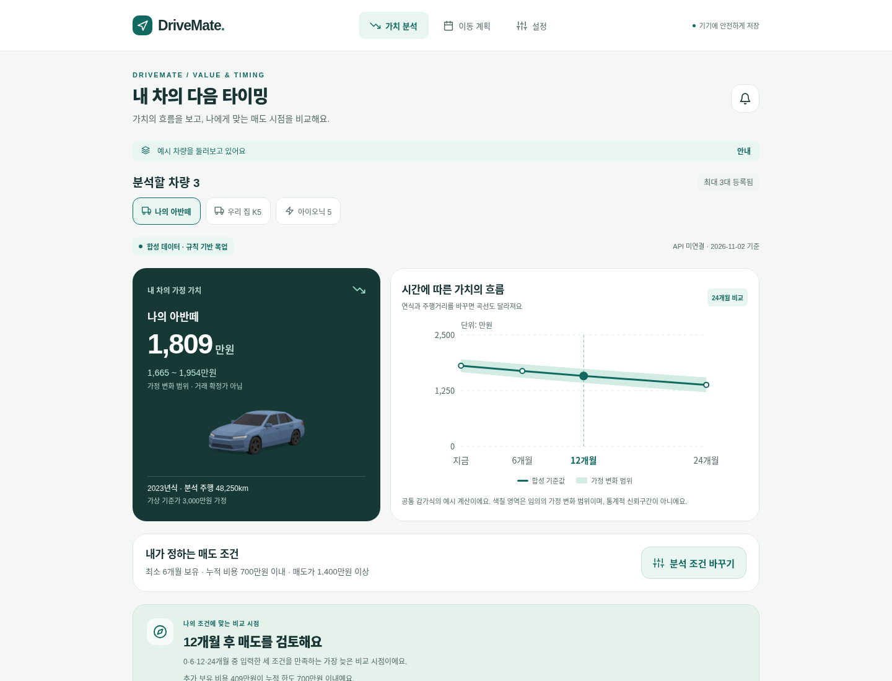
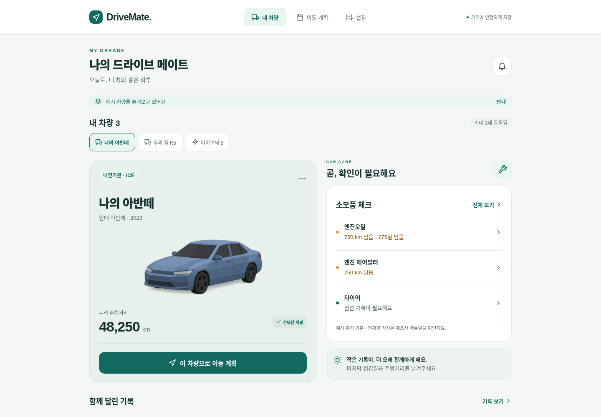

# make_drive_mate

팀 인수: [디버깅 → 백엔드 → 프런트 분담](docs/TEAM-HANDOFF.md) · [Word/PPT/노트북 수정 위치](docs/DOCUMENT-CHANGE-MAP.md) · [추가 차량 자료 19개 검토](docs/RAG-SOURCE-REVIEW.md).

내 차를 **얼마나 더 탈지** 판단하도록, 가치 변화·추가 보유비용·개인 조건을 함께 비교하는 Expo 앱입니다. **API 키와 서버 없이 합성 예시를 시연할 수 있습니다.** 서버 로그인 후에는 온비드 실측 자료로 학습한 공매 낙찰가 모델과 데이터 품질·평가 결과를 별도로 조회합니다.

공개 코드 대상은 [cloud-project-mobility/make_drive_mate](https://github.com/cloud-project-mobility/make_drive_mate)입니다. 실제 모델·GPT·문서 검색의 로컬 실행과 담당별 디버깅 순서는 [팀 인수 안내](docs/TEAM-HANDOFF.md), 최신 검증 범위는 [인수 메모](docs/DELIVERY-NOTES.md)를 따릅니다. 현재 AWS 공개 서비스는 배포되어 있지 않습니다. 데이터·모델·원본 문서·검색 인덱스·키는 이 공개 저장소에 포함하지 않습니다.

## 새 목업 실행

```sh
npm ci
npm run web
```

브라우저에서 **예시 차량으로 둘러보기 → 가치 분석 → 분석 조건 바꾸기**를 선택합니다. 기본 예시는 2026-11-02 기준 아반떼 2023년식 / 48,250km입니다.

- 연식·누적거리·월 예상 주행량을 바꾸면 0·6·12·24개월 가치 곡선이 갱신됩니다.
- 최소 보유기간·누적 비용 한도·목표 매도가를 모두 만족하는 가장 늦은 비교 시점을 설명합니다. 조건이 맞지 않거나 이력이 불명확하면 판단을 유보합니다.
- 최근 받은 매입견적과 날짜를 선택 입력하면 그 금액을 현재 기준점으로 사용합니다. 미래 변화는 여전히 가정이며, 입력 견적은 확정 거래가가 아닙니다.
- 감가와 입력 유지비, 6개월에서 12개월로 더 이용하는 월평균 추가비용을 분리해 보여줍니다.
- 아래의 기존 예시 가격은 합성 규칙이며 가정폭은 통계적 신뢰구간이 아닙니다. 별도 **공매 데이터로 차량 분석** 화면은 실제 온비드 자료로 학습한 모델을 호출합니다. 공매 낙찰가는 소비자 시세와 다르며, 차령·주행거리 변화는 시장 조건을 고정한 시나리오입니다.
- 분석 조건은 화면 메모리에서 관리합니다. 기존 차량 저장·백업 계약을 보존하며, 차량 전환·새로고침 시 분석 조건은 초기화됩니다.



발표자료와 대본 원본은 팀의 비공개 제출 폴더에서 관리합니다. 원본 편집 링크와 Office 파일은 공개 코드 저장소에 포함하지 않습니다.

## 역할별 산출물

1. [팀 인수·분담 안내](docs/TEAM-HANDOFF.md) — 디버깅, 백엔드, 프런트엔드 순서와 완료 기준.
2. [원본 자료 위치별 수정표](docs/DOCUMENT-CHANGE-MAP.md) — PoC·중간보고서·발표자료의 교체 문구와 근거.
3. [문서 수정 프롬프트](docs/DOCUMENT-UPDATE-PROMPT.md) — 원본 양식을 유지하며 최신 구현·검증 상태를 반영하는 지침.
4. [코드 전용 모델 비교 노트북](notebooks/README.md) — 데이터와 출력 없이 저장소의 학습 코드를 재사용하는 실행 안내.

Word·PowerPoint 원본과 실제 데이터가 내장된 Colab 실행용 사본은 별도 비공개 자료입니다. 새 clone에 해당 파일이 포함되어 있다고 가정하지 않습니다.

[새 구현 계약](docs/PIVOT-IMPLEMENTATION.md) · [데이터·모델 조사](docs/PIVOT-RESEARCH.md) · [전환 검증 기록](docs/PIVOT-VALIDATION.md)

## 기존 앱 기반

아래는 재사용한 차량 관리·주행·선택적 서버 연동 기능입니다. 새 가치 분석에는 제조사·지도·캘린더 API가 필요하지 않습니다.

차량 관리, 점검 기록, 출발 계획, GPS 주행 기록을 연결한 **React Native / Expo / TypeScript + Spring Boot / JDBC** 앱입니다. 제공된 Penpot의 17개 화면을 바탕으로 기기 저장과 계정별 서버 백업, 장소 검색·경로 계산·캘린더·차량 상태 조회를 연결했습니다. 외부 API 키 없이 명시적인 예시 모드로 실행하고 검증할 수 있습니다. iOS·Android와 같은 코드의 웹 미리보기를 제공합니다.



## 실행

Node.js 24 LTS와 npm을 사용합니다.

HTTPS 웹 배포는 기본적으로 현재 웹 주소의 `/api/v1`에 연결합니다. 별도 API 주소가 필요하면 **빌드 시** `EXPO_PUBLIC_API_BASE_URL=https://API주소`를 지정하세요. 모바일 앱·Expo QR 실행에는 웹 주소 자동 선택이 없으므로 해당 변수 또는 앱 설정에 휴대전화에서 접근 가능한 HTTPS/LAN 서버 주소를 입력해야 합니다. 기기에서 `127.0.0.1`은 PC가 아닌 기기 자신입니다. 이 변수는 공개 API 주소 전용이며 비밀키를 넣지 않습니다.

```sh
npm ci
npm start           # Expo 개발 서버, QR 코드
npm run android     # 연결한 Android 또는 실행 중인 에뮬레이터
npm run ios         # macOS의 iOS 시뮬레이터
npm run web         # 브라우저 미리보기
```

서버 연동까지 시연하려면 Java 17 이상을 설치하고, Linux/WSL의 별도 터미널에서 실행합니다. 계정·백업·외부 연동의 예시 모드는 키 없이 실행됩니다. Maven 래퍼는 최초 실행 시 공식 배포본을 내려받아 체크섬을 검증합니다.

```sh
npm run build:backend
npm run backend     # http://127.0.0.1:18085, 기본 mock 모드
```

앱의 **설정 → 서버 연결 확인 → 로컬 테스트 계정 만들기**부터 시작합니다. [Spring 외부 연동 안내](backend-spring/PROVIDERS.md), [온비드 수집·전처리](docs/ONBID-DATA.md)를 참고하세요. 학습 모델 추론에는 Python 환경과 학습 산출물이 추가로 필요하며, Spring이 제한된 Python 작업 프로세스를 호출합니다. 예전 `backend/app`의 Python HTTP 서버는 기본 실행 경로가 아닙니다.

Expo SDK 57 / React Native 0.86 / React 19를 사용합니다. SDK 57 호환 Expo Go 또는 개발 빌드가 필요합니다. Expo Go 지원 버전은 배포 시점에 달라질 수 있습니다. 별도 API 키 없이 로컬 기능을 사용할 수 있습니다. 기기 위치·알림은 사용자가 해당 버튼을 누를 때만 권한을 요청합니다.

## 사용할 수 있는 기능

- **첫 시작:** 빈 차량 목록으로 시작하거나 명확히 표시된 예시 차량 3대로 체험합니다. 회원가입 없이 사용하며 비밀번호를 수집하지 않습니다.
- **내 차량:** 최대 3대 등록·선택·수정·삭제. 차량 이름과 누적 주행거리는 모든 화면에서 같은 상태를 사용합니다. 차량을 삭제할 때 연결된 기록과 출발 알림도 정리합니다.
- **소모품:** 내연기관·하이브리드·전기차별 목록, 실제 점검일·주행거리·메모 입력, 거리와 날짜 중 먼저 도래하는 기준으로 안내합니다. 기록이 없으면 정상으로 추정하지 않습니다. 기본 주기는 원본의 예시이며 차량별 제조사 권장값이 아닙니다.
- **이동 계획:** 출발지·도착지·도착 날짜·운전 예상·주차 후 도보·여유 시간을 입력합니다. 출발 시간이 전날로 넘어가는 경우 날짜도 표시합니다. Google Maps에서 실제 경로를 열 수 있습니다.
- **주행 기록:** 명시적으로 시작한 뒤 실제 위치 이벤트를 받아 거리·시간을 기록합니다. 부정확한 위치, 순간 이동, 정지 중 흔들림을 걸러냅니다. 앱이 가려지면 일시 정지하고, 돌아오면 직접 재개합니다. 저장 시 해당 차량의 누적 거리에 한 번만 반영합니다.
- **알림·설정:** 기본 도보·여유 시간 저장, 모바일의 계획별 로컬 출발 알림, 권한 거부 안내, 지난 출발 시간 표시.
- **기기 데이터:** 재실행 후 복원, 손상 데이터 보호, 저장 실패 안내·재시도, JSON 백업 내보내기와 검증·확인 후 복원. 진행 중인 기록은 재실행 시 일시 정지 상태로 복구합니다.
- **서버 백업:** 로컬 이메일/비밀번호 계정, 계정별 저장·명시적 복원, 버전 충돌 안내, 같은 요청 재전송의 중복 저장 방지. 세션 만료·로그아웃 후에도 기기 기록은 유지합니다.
- **서버 연동:** 장소 검색 결과의 좌표를 골라 출발 시각을 계산하고, 종일·장소 없는 캘린더 일정을 구분해 가져옵니다. 차량 예시 상태는 기존 누적 주행거리에 합산하지 않습니다. Google 사용자 동의·토큰 갱신 코드는 실제 키 없이 가짜 HTTP 응답으로 검증합니다.

## 연동 범위와 한계

기기 기능은 서버 없이 사용할 수 있습니다. 선택적으로 사용하는 Spring 백엔드는 실제 계정과 JDBC 저장소(로컬 H2, 배포 PostgreSQL)를 제공하며, 외부 데이터 기본값은 **mock**입니다. 예시 데이터는 실제 Google·Kakao·현대 계정 연결을 뜻하지 않습니다. Kakao 검색·길찾기와 Google Calendar OAuth 연결 경계는 구현되어 있지만 실제 키·동의로 호출한 검증은 수행하지 않았습니다. 현대 실차 연결은 아직 지원하지 않습니다. 기존 Python 서버의 계정·세션·암호화 토큰을 자동 이전하지 않으며 Google 연동에는 다시 동의해야 합니다.

서버 백업은 사용자가 저장·복원하는 스냅샷이며 자동 병합·오프라인 전송 큐는 없습니다. 가져온 캘린더 일정의 원본 수정·취소도 자동 전파되지 않습니다. 내장 지도 SDK, 5분마다 자동 경로 조회, Google 계정으로 앱 로그인, 이메일 확인·비밀번호 복구는 제공하지 않습니다. 상세 범위는 [연동 문서](docs/INTEGRATION.md)에 있습니다.

지도 화면은 **경로 개요 도식**입니다. 실제 지도·거리·교통은 외부 지도 앱으로 확인합니다. GPS는 **화면에서 활성화된 앱에서만 측정**하고, 자동 감지·백그라운드 측정을 하지 않습니다. 내비게이션 앱 전환·화면 잠금 시 측정이 멈춥니다. 좌표 사이 직선 거리의 합이므로 계기판이나 도로 거리와 차이가 날 수 있습니다. 주행 중 화면 조작은 피하세요.

GPS 중간 상태는 약 5초마다, 정지 시 추가 저장합니다. 강제 종료 직전의 일부 데이터는 손실될 수 있습니다. GPS 좌표 이력은 저장하지 않고 누적 거리만 보관합니다. 장소 검색에서 고른 계획의 출발·도착 좌표와 경로 출처·계산 시각은 저장하며 지도 앱에도 선택 좌표를 전달합니다. 로컬 저장소는 암호화된 클라우드 보관함이 아니며 앱 삭제·저장소 삭제 시 사라집니다. 필요한 기록은 설정에서 별도 백업하세요. 백업에는 차량 이름, 이동 장소·선택 좌표와 시간이 들어갑니다.

## 검증

```sh
npm run check       # TypeScript + ESLint + 도메인 테스트
npm run check:backend # Spring 계정·저장·공급자·분석 API 테스트
npm run build:backend # 통합 브라우저 검증 전에 실행 파일 생성
npm run test:integrated # 새 임시 DB의 mock 서버 + 전체 Playwright 실제 HTTP 연동
npx expo-doctor
npx expo export --platform all
```

`npm run test:integrated`는 18086 포트에서 별도 H2 메모리 DB의 Spring 서버를 시작하고 종료 후 정리합니다. `npm run test:e2e`만 실행하고 `DRIVEMATE_BACKEND_URL`을 생략하면 백엔드 연동 테스트는 건너뜁니다. 공매 화면 브라우저 검증은 합성 응답으로 단위·상태·화면 계약을 확인하며 유료 LLM을 호출하지 않습니다. 실제 모델 성능은 저장된 평가 보고서에서 확인합니다.

통합 검증용 웹 서버는 `127.0.0.1:18087`에서 별도로 실행합니다. 생성된 배포본을 검증하려면 먼저 `npm run export:web`을 실행한 뒤 `DRIVEMATE_WEB_STATIC=1 npm run test:integrated`를 사용하세요. 일반 개발 서버도 `.env*`·백엔드·문서 원본을 Metro의 탐색 및 직접 URL 제공 대상에서 차단합니다.

최초 Playwright 실행 전 `npx playwright install chromium`을 실행합니다. 시스템 Chromium을 쓰려면 `PLAYWRIGHT_CHROMIUM_EXECUTABLE_PATH=/usr/bin/chromium`을 지정할 수 있습니다. CI는 Node 24에서 같은 검증과 웹·Android·iOS 번들 생성을 실행합니다. 상세 결과와 검증 한계는 [검증 기록](docs/VALIDATION.md)에 있습니다. native JS/Hermes 번들 생성은 서명된 APK/IPA 빌드 또는 실기기 시험과 다릅니다.

## 구조

```text
src/app/          Expo Router 화면과 보호된 탐색
src/components/   공통 UI, 테마, 차량 이미지
src/screens/      사용자 화면
src/domain/       타입, 상태 전이·검증, 점검·시간·GPS 계산, 단위 테스트
src/state/        AsyncStorage 영속성, 복구, 오류 처리
src/services/     위치 측정 생명주기, 기기 알림, 백업
backend-spring/   Spring HTTP API·계정·JDBC 저장·공급자·Google OAuth
backend/scripts/  온비드 수집·전처리·모델 학습·추론 작업
backend/app/      이전 Python HTTP 구현(기본 서버에서 사용하지 않음)
tests/e2e/       실제 화면 조작을 통한 통합 검증
```

[17개 화면 UX 조사](docs/UX-AUDIT.md), [연동 확장 지점](docs/INTEGRATION.md), [원본 화면 모음](docs/evidence/penpot-original.jpg)을 함께 제공합니다. 차량 일러스트 3종은 사용자가 제공한 Penpot 파일에서 가져왔고, 출처는 UX 조사 문서에 기록했습니다. 자동 검증과 전문가 점검을 수행했으며 실제 사용자 연구를 수행했다고 주장하지 않습니다.

사용자 제공 Penpot 원안(공유 링크 비공개) · [Expo 시작 안내](https://docs.expo.dev/get-started/create-a-project/) · [SDK 57 문서](https://docs.expo.dev/versions/v57.0.0/)
