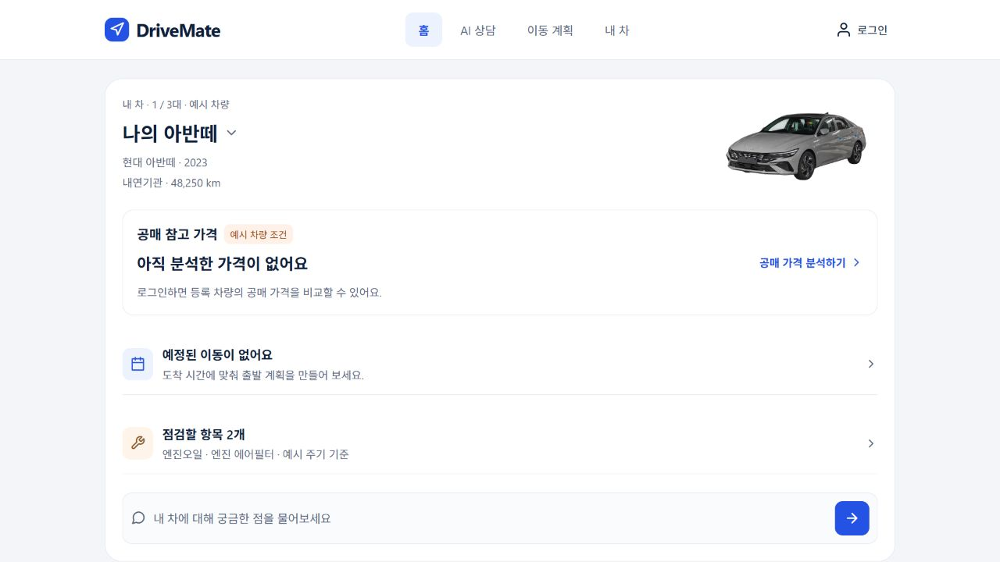
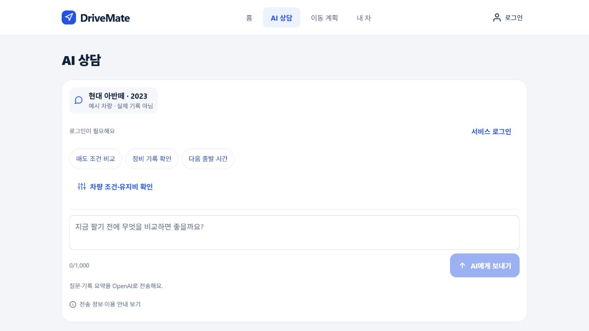
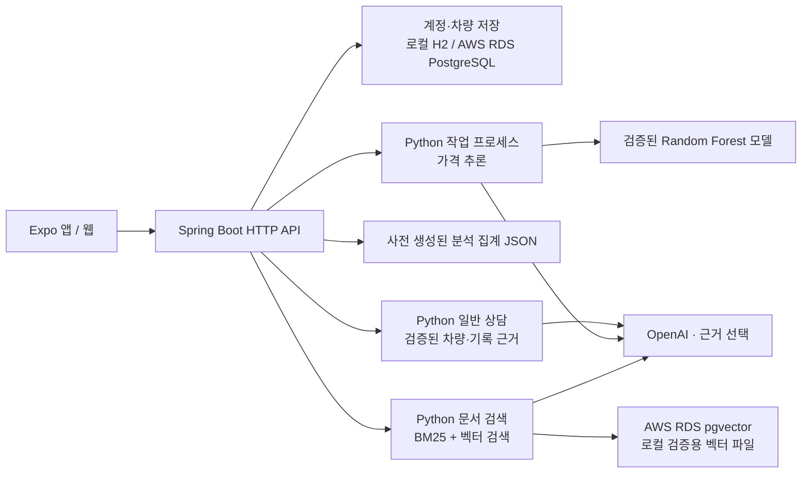
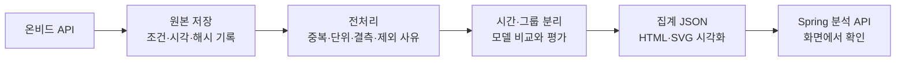

# DriveMate · make_drive_mate

차량 정보를 등록하고 **현재 조건의 공매 참고 가격, 향후 보유 시나리오, 판단 근거**를 함께 확인하는 차량 관리·분석 프로젝트입니다. 차량 가격은 ML이 계산하고, GPT는 차량·정비·이동 계획에 관한 일반 상담과 근거 설명을 담당합니다. 프로젝트 문서 검색은 별도의 허용 계정 기능입니다.

**현재 기본 백엔드는 Spring Boot입니다.** Python은 데이터 수집·전처리·학습·추론·문서 검색 작업을 담당합니다. `backend/app/`에 남아 있는 FastAPI 코드는 이전 구현이며 기본 실행 서버가 아닙니다.

[팀 작업 분담](docs/TEAM-HANDOFF.md) · [전체 구조](docs/ARCHITECTURE.md) · [문서 수정 위치](docs/DOCUMENT-CHANGE-MAP.md) · [GitHub Actions](https://github.com/cloud-project-mobility/make_drive_mate/actions)

배포 웹 로그인과 비밀번호 변경은 [계정 사용 안내](docs/ACCOUNT-ACCESS.md)를 확인하세요. 준비된 소유자 계정의 최초 비밀번호는 사용자가 나중에 WSL 도우미에서 직접 설정하기로 했으며, 아직 변경하지 않았습니다. 일반 사용자는 웹에서 회원가입할 수 있습니다.

## 현재 구현 상태

운영 확인: **ECS Fargate API revision 6·cycle revision 6와 공개 HTTPS/WSS 서비스**. **[DriveMate 웹 열기](https://d2a3l7qimjk3ir.cloudfront.net)**. 기존 RDS를 재사용하며 첫 데이터 사이클·API 집계 갱신이 성공했고 주간 요청과 시간 단위 worker 예약도 활성화했습니다. 이전 EC2·CloudFront·VPC origin 정리도 완료했습니다. 공개 저장소의 소스와 별도로 준비한 비공개 데이터가 필요한 기능을 구분합니다.

**UI 03은 소스 `9c50cfc9`의 v7 이미지로 운영 배포됐습니다.** 공개 상태 응답과 HTML·웹 번들의 해시가 검증본과 일치합니다. 같은 소스의 [새 Android APK 빌드](https://github.com/cloud-project-mobility/make_drive_mate/actions/runs/41861259652)는 내부용 APK 생성·정적 검사를 완료했으며, 실제 휴대전화 검증은 아직입니다. [UI 03 변경·검증 범위](docs/UI-03.md)

| 영역          | 구현·검증 상태                                                                                                | 실행 조건·남은 일                                                                                                                                                 |
| ------------- | ------------------------------------------------------------------------------------------------------------- | ----------------------------------------------------------------------------------------------------------------------------------------------------------------- |
| 프런트엔드    | React Native / Expo / TypeScript. UI 03 홈·AI 상담·이동 계획·내 차, 단계별 가입·차량 등록 운영 반영           | 공개 화면·파일 검증과 새 내부용 APK 생성·정적 검사 완료. 모바일 실기기 검증은 별도                                                                                |
| Android APK   | UI 03 소스 `9c50cfc9`의 내부용 APK 생성·서명·권한·ABI·내장 API 주소 및 비밀값 검사 완료                       | [APK 안내](docs/ANDROID-APK.md). debug 서명·versionCode 1. 최신 APK의 에뮬레이터·실제 폰·앱 API 호출 미검증; 이전 버전의 System UI ANR 관측은 별도 이력           |
| Spring API    | Spring Boot 4.1.2 / Java 17 / JDBC. 로그인, 비밀번호 변경, 계정별 차량·백업, 가격·분석·문서·상담 API          | ECS API revision 6·Nginx 정상, 기존 RDS 재사용. 최신 로그인·상담·로그아웃 확인; Kakao 검증은 revision 3 이력                                                      |
| 가격 모델     | 온비드 정제 2,197행 기반 Random Forest. AWS HTTPS 지원 차량·템플릿 응답 확인                                  | 14,867행 새 모델은 평가 후보이며 서비스에 승격하지 않음. 모델·데이터는 공개 저장소 제외                                                                           |
| GPT 상담·설명 | ECS revision 6에서 유료 상담 1건 `gpt-6-astra` 응답 확인. 가격은 `random_forest_log`가 계산하고 LLM 생성 아님 | 연결·응답 구조 확인이며 일반 정확도 평가가 아님. 이전 [문서 평가 10건](docs/RAG-EVALUATION-20261104.md)은 자동 8/10, 추가 원문 대조 결과 별도                     |
| 문서 RAG      | 6개 문서·83개 청크. RDS pgvector 적재와 최종 ECS HTTPS 검색·권한 검증 완료                                    | 공개 경로에서 출처 6개·다른 계정 403 확인. 이 검증은 `use_llm=false` 검색이며 새 LLM 품질 평가가 아님                                                             |
| 실시간 위치   | 웹에서 같은 계정 기기의 최근 위치 중계·중지, 다른 계정 격리                                                   | AWS HTTPS/WSS에서 합성 좌표로 검증. 이 동기화 화면은 웹 전용이며 Android APK에서는 미지원                                                                         |
| 데이터 사이클 | 첫 ECS 실행 성공, S3와 공개 API 집계 일치. 새 API cycle 정제 2,187행                                          | 주간 요청·시간 단위 worker 예약 활성화. 새 후보의 모델 자동 승격 없음; 첫 정기 실행 관측은 별도                                                                   |
| CI            | 이전 커밋 `76ae3787`의 Spring·Python·웹·release 성공 이력                                                     | 최신 `9c50cfc9`의 [CI 실행](https://github.com/cloud-project-mobility/make_drive_mate/actions/runs/41861245740)은 진행 중. 원격 최종 결과와 수동 배포 검증을 구분 |
| AWS / CD      | Fargate 1 task·CloudFront 정상, 공개 검증·이전 EC2 정리 완료. 현재 이미지 ECR 기본 OS 검사 완료               | **CD 미활성**: GitHub OIDC 조회가 조직 SCP에 거절됨. 후속 배포 작업은 의도대로 건너뜀                                                                             |

공개 clone에는 **소스·테스트·기술 문서·코드 전용 노트북**이 있습니다. API 키, 계정 DB, 원시·정제 데이터, 학습 모델, 원본 Word/PPT, 문서 본문·검색 인덱스, 데이터가 내장된 Colab 사본은 포함하지 않습니다.

## 사용자 흐름과 기능

1. **계정 만들기 → 차량 등록** 순서로 시작합니다. 기존 계정은 **이미 계정이 있어요**를 선택합니다. 제조사·모델·연식, 구동 방식, 주행거리를 확인하고 **등록하고 시작하기**를 누르면 실제 계정 차량 저장 후 홈으로 이동합니다.
2. **홈**에서 선택한 차량과 다음 이동·점검 항목을 봅니다. 공매 가격은 같은 로그인 세션·차량 정보로 분석한 결과가 있을 때만 표시하며, 아직 없거나 근거가 부족하면 가격을 만들지 않습니다.
3. **AI 상담**에서 질문을 직접 보내거나 차량 조건·유지비를 확인합니다. **입력 확인하고 공매 가격 분석**은 ML만 실행하고, **AI에게 보내기**는 별도로 유료 GPT 상담을 요청합니다. 가격 숫자와 미래 보유 조건의 비교는 ML 결과로 제공합니다.
4. **내 차**에서 최대 3대의 차량, 주행·정비 기록을 관리합니다. 카탈로그 사진은 차종 참고 이미지이며 실제 차량의 상태 증빙이 아닙니다.
5. **이동 계획**에서 예정·완료 기록을 구분하고, 도착 시간과 운전·도보·여유 시간으로 출발을 계획합니다. GPS 기록과 알림은 사용자가 직접 시작합니다.
6. 상단 계정 아이콘의 **내 계정**에서 보안·외부 연동·백업을 펼칩니다. **참고 자료 → 가격 분석 상세 / 프로젝트 자료**로 기존 분석·문서 화면에 들어갑니다. 프로젝트 문서 검색은 서버가 사전 허용 계정인지 검사합니다.

계정 없이 둘러보는 보조 경로도 유지합니다. **예시 차량으로 둘러보기**는 합성 차량·기록을, **내 차량으로 시작하기**는 빈 기기 기록을 사용합니다. 로그아웃 상태의 설정은 로그인 폼을 먼저 보여 주며, 기존 기기 사용자는 **기기 설정 보기**를 눌러 운전·알림 및 데이터 관리를 펼칠 수 있습니다.

기기 기록 전체가 자동으로 계정에 동기화되지는 않습니다. 로그인 중 차량을 등록·수정하면 차량 API로 저장하고, 주행·정비·이동 계획의 **계정별 서버 백업은 사용자가 직접 저장·복원**합니다. 초기화·복원 확인과 진행 중인 주행 보호는 유지합니다. 로그인 토큰과 상담 대화·가격 결과는 메모리에 두며, 앱이나 웹을 다시 열면 재로그인이 필요합니다.

기존 **가격 분석 상세**의 오프라인 가치 비교는 별도 합성 계산입니다. 0·6·12·24개월의 가치·입력 유지비·목표 매도가·최소 보유기간을 비교하지만 미래 변화는 가정이며 통계적 신뢰구간이 아닙니다. 새 홈의 실제 ML 결과와 섞어 표시하지 않습니다.

로컬 기본 실행의 지도·캘린더 외부 연동은 명시적인 예시 데이터입니다. AWS 배포의 Kakao 장소·경로 API는 실제 호출을 확인했으며, 현대 차량 연동은 연결 준비 단계로 실차 API 구현·차량 동의·검증이 미완료입니다.

웹의 **이동 계획 → 실시간 위치**에서는 로그인한 같은 계정의 기기를 연결하고, 내 기기 위치 전송을 직접 시작·중지할 수 있습니다. Spring WebSocket으로 최근 위치만 중계하며 좌표를 DB나 이동 경로 이력에 저장하지 않습니다. 카카오 지도는 별도로 연결한 경우에만 불러옵니다. 휴대전화·PC의 위치이며 현대 차량 자체의 위치 조회가 아닙니다. [위치 연결](docs/REALTIME-LOCATION.md) · [웹 지도 설정](docs/LIVE-MAP.md)

### UI 03과 이전 화면

UI 03은 **홈 / AI 상담 / 이동 계획 / 내 차**의 4개 탭과 별도 계정 화면으로 정리했습니다. 작은 화면에서는 하단 탭, 넓은 화면에서는 상단 탐색을 사용합니다. 로그인·차량 등록은 한 단계씩 진행하고, 관리 기능은 접힌 메뉴에 둡니다. [화면별 동선과 검증 상태](docs/UI-03.md)를 참고하세요.

2026-11-05 운영 웹에서 캡처한 화면입니다. **예시 차량·비로그인 상태**로 공매 가격은 표시하지 않습니다. 실제 사용자 차량이나 유료 상담 결과 화면이 아닙니다.





[2026-11-04 데스크톱 화면](docs/evidence/2026-11-04/current-ui-desktop.png)과 [모바일 화면](docs/evidence/2026-11-04/current-ui-mobile.png)은 **UI 03 이전 구현 기록**입니다. 최신 화면 이미지나 새 배포·APK의 증거로 사용하지 않습니다. [차량 사진 출처·이용 조건](docs/VEHICLE-PHOTOS.md)

## 시스템 구조



Spring이 인증·접근 권한·입력 검증·요청 한도를 처리하고, 고정된 Python 작업을 제한된 프로세스로 호출합니다. 프런트엔드가 Python HTTP 서버나 OpenAI에 직접 연결하는 구조가 아닙니다.

| 구성           | 기술                                                                                      |
| -------------- | ----------------------------------------------------------------------------------------- |
| 앱·웹          | Expo SDK 57, React Native 0.86, React 19, TypeScript                                      |
| API·계정 저장  | Java 17, Spring Boot 4.1.2, JDBC, H2 / PostgreSQL                                         |
| 분석·학습      | Python 3.12, scikit-learn, Random Forest / Extra Trees 비교                               |
| 설명·검색      | GPT `gpt-6-astra`, `text-embedding-3-small` 1,536차원, BM25 + RRF                         |
| AWS 운영 구성  | CloudFront → ALB → ECS Fargate의 Nginx·Spring·Python, RDS, S3, SQS                        |
| 검증·배포 설정 | GitHub Actions, JUnit, Python unittest, Playwright, 코드 전용 이미지·ECR digest 배포 설정 |

목표 API task는 **1 vCPU·3 GiB·replica 1**입니다. 위치 중계가 메모리에 있어 배포 교체 중 재연결이 필요합니다. 별도 cycle task는 SQS 메시지를 한 번 확인하고 종료합니다. 코드만 이미지에 넣고 비공개 모델·집계는 S3에서 해시를 검증해 읽습니다. DB 스키마·문서 색인·소유자 초기화는 일반 API task에서 실행하지 않습니다. [컨테이너 실행 계약](infra/containers/README.md)

## 로컬 실행

아래 명령은 **Linux / WSL의 Bash**에서 저장소 루트를 기준으로 실행합니다. Node.js 24와 npm, 백엔드 실행에는 JDK 17 이상이 필요합니다. Maven 래퍼는 처음 실행할 때 배포본을 내려받고 체크섬을 확인합니다.

### 1. 소스 설치와 예시 화면

```bash
git clone https://github.com/cloud-project-mobility/make_drive_mate.git
cd make_drive_mate
npm ci
npm run web
```

브라우저에서 **예시 차량으로 둘러보기**를 선택하면 홈·내 차·이동 계획을 서버 없이 확인할 수 있습니다. 아직 공매 분석을 실행하지 않았다면 홈에는 가격이 표시되지 않습니다. 이 둘러보기에는 API 키·학습 모델·서버 계정이 필요하지 않습니다. `npm start`, `npm run android`, macOS의 `npm run ios`로 모바일 개발을 시작할 수도 있습니다.

### 2. Spring 계정·차량 API까지 실행

별도 터미널 A에서:

```bash
npm run build:backend
npm run backend
```

API는 `http://127.0.0.1:18085`에서 실행됩니다. 기본값은 로컬 H2와 외부 제공자 `mock` 모드입니다.

별도 터미널 B의 같은 저장소에서 실행합니다. 앞서 웹 서버를 켜 두었다면 포트가 겹치지 않도록 종료한 뒤 실행하세요.

```bash
npm run web -- --localhost --port 8081
```

`http://127.0.0.1:8081`에서 **계정 만들기 → 로컬 테스트 계정 만들기 → 차량 등록**으로 진행합니다. 이미 기기 체험을 시작했다면 상단 **로그인 및 설정 → 회원가입으로 전환**을 선택합니다. 서버 주소를 확인·변경하려면 **서버 설정 펼치기 → 서버 연결 확인**을 사용합니다. 로컬 HTTP 웹의 API 기본 주소는 `http://127.0.0.1:18085`입니다. `http://127.0.0.1:18085/api/v1/health`에서도 Spring 상태를 확인할 수 있습니다.

HTTPS 웹은 현재 웹 주소를 API 기본값으로 사용합니다. 별도 API 주소가 필요하면 빌드 시 `EXPO_PUBLIC_API_BASE_URL`을 설정하고 서버의 CORS 허용 주소도 맞춥니다. 이 공개 변수에는 API 주소만 넣습니다. 모바일에서 `127.0.0.1`은 휴대전화 자신이므로 기기에서 접근할 수 있는 서버 주소가 필요합니다.

웹 위치 권한은 HTTPS 또는 localhost에서 사용합니다. 카카오 지도에는 JavaScript SDK용 공개 키 `EXPO_PUBLIC_KAKAO_JAVASCRIPT_KEY`와 실제 웹 주소의 도메인 등록이 필요합니다. GitHub Actions도 같은 이름의 저장소 **변수**를 사용합니다. OpenAI·온비드·카카오 REST·현대 Client Secret은 공개 변수에 넣지 않습니다.

### 3. 실제 ML·GPT·RAG 사용

기본 서버가 켜졌다는 사실만으로 실제 모델과 문서 검색이 준비되지는 않습니다.

| 기능             | 추가 준비                                                                                 |
| ---------------- | ----------------------------------------------------------------------------------------- |
| 온비드 신규 수집 | 승인된 API 키. [수집·전처리 안내](docs/ONBID-DATA.md)                                     |
| 가격 추론        | Python 환경, ML 의존성, 검증된 모델 파일·해시·서버 경로. [모델 안내](docs/ONBID-MODEL.md) |
| 분석 집계        | 성공한 사이클의 집계 파일. [반복 분석 안내](docs/CYCLE.md)                                |
| GPT 상담·설명    | 서버의 OpenAI 키와 설명 허용 설정                                                         |
| 문서 검색        | 승인·가림 처리한 문서, 임베딩 인덱스, OpenAI 키, 허용 계정. [RAG 안내](docs/RAG.md)       |

기존 비공개 자료를 준비한 환경의 실행 절차는 [팀 인수 안내](docs/TEAM-HANDOFF.md)를 따릅니다. `scripts/run-local-backend.py`는 해당 자료와 정해진 경로가 이미 있는 환경용이며, 새 clone만으로 실행하는 시작 명령이 아닙니다. 키와 개인정보는 Git에 올리지 않습니다.

## 데이터 수집·분석 사이클



`backend/scripts/onbid_pipeline.py`가 사이클을 실행합니다. 실패한 실행이 마지막 성공 결과를 덮어쓰지 않으며, 새 후보 모델을 서비스 모델로 자동 교체하지 않습니다. 운영 경로는 EventBridge → SQS → 별도 ECS 일회 worker → S3 집계 → API의 집계 갱신이며 첫 실행과 공개 API 갱신이 성공했습니다. 주간 요청은 월요일 02:00 KST, worker는 매시 05분에 실행되도록 활성화했습니다. worker는 큐가 비면 종료하므로 매시간 새 데이터를 수집한다는 뜻은 아닙니다. 첫 정기 실행의 실제 성공 여부는 이후 관측해야 합니다.

현재 모델 데이터의 **개찰일 기준 조회 기간은 2025-11-04~2026-11-03**이며 실제 수집일은 2026-11-04입니다. 원본 5,268행 → 승용 범주 2,284행 → 정제 2,197행이며, 폐차·고철·점검용·다수 차량 묶음과 단위가 불명확한 자료를 구분했습니다.

첫 ECS API 사이클은 같은 조회 기간에 13회 호출하여 원본 5,268행 → 승용 범주 2,284행 → 정제 **2,187행**을 만들었습니다. 전체 제외 3,081행과 반복 물건 그룹 154개를 보고했으며 S3 완료 표식·집계 저장, 예약된 API 호출 0건, 빈 SQS·DLQ를 확인했습니다. 이 실행 결과는 기존 서비스 모델의 2,197행 학습본과 구분하며 모델을 자동 교체하지 않습니다.

추가로 받은 온비드 목록 **54,815건을 정제해 14,867건**을 확보했습니다. 기존 기준본과 동일한 사건은 2,187건이고 새 사건은 12,680건입니다. 원본 해시·제외 사유·반복 물건 그룹·민감 차량 속성을 검사했으며, 로컬 내보내기 파일의 가져오기 완료와 원 수집의 완전성은 구분합니다. 이 자료로 후보를 학습·평가했지만 **서비스 모델과 RAG 인덱스는 기존 검증본을 유지합니다**. [가져오기·전처리](docs/ONBID-DATA.md) · [후보 평가와 한계](docs/ONBID-MODEL-CANDIDATE-v3.md)

## 모델과 성능 평가

중앙값 기준 모델, Random Forest, Extra Trees를 비교해 검증 구간 MAE로 **로그 가격 Random Forest**를 선택했습니다. 시간순 훈련·검증·구간 보정·최종 시험을 나누고, 물건관리번호 기준 그룹이 시간 경계에 걸치면 제외했습니다. 물건관리번호만으로 모든 물리 차량의 중복을 식별할 수 있는 것은 아닙니다.

| 평가 범위                                  |  표본 |        MAE | 해석                            |
| ------------------------------------------ | ----: | ---------: | ------------------------------- |
| 전체 최종 시험                             | 341건 | 236.15만원 | 전체 시험 결과                  |
| 사전에 정한 가격 제공 조건에 맞는 부분집합 | 262건 | 134.74만원 | 제공률 76.83%, 나머지 79건 유보 |

조건부 결과는 전체 성능을 대신하지 않습니다. 예측 대상은 **공매 낙찰가격**이며 소비자 중고차 시세·확정 매입견적과 다릅니다. 미래 표시는 시장 조건을 고정하고 차령·주행거리를 바꾼 시나리오로, 실제 미래 시장가격이나 최적 매도일을 검증한 결과가 아닙니다. 사고·정비·세대·트림 정보와 보유비용 데이터도 충분하지 않습니다.

상세 분할·오차·제공 조건은 [모델 문서](docs/ONBID-MODEL.md), 재현 코드는 [코드 전용 노트북](notebooks/README.md)에 있습니다. 기존 원본 부스팅 노트북의 점수를 현재 차량 모델 성능으로 사용하지 않습니다.

남은 제품 작업은 **실제 ML 결과와 사용자의 매도 목표·최소 보유기간을 함께 적용하는 추천 흐름**, 실제 미래 시장가격 검증과 보유비용 근거 확보입니다. 현재 오프라인 합성 계산의 매도 조건 비교를 이 ML 통합의 완료로 표현하지 않습니다. 신규 차량 관련 RAG 자료 확대, 팀원 모바일 검증, 원본 PoC·중간보고서·PPT 수정도 남아 있습니다.

## RAG 구성과 문서 사용

문서 검색은 가격 모델과 분리되어 있습니다. 현재 6개 문서는 PoC·중간보고서·발표자료 사본, 온비드 공식 목록·상세 설명, 검증된 모델 평가 기록입니다.

- 개인정보를 가린 본문을 `text-embedding-3-small`로 임베딩합니다.
- 한국어 BM25와 코사인 검색 결과를 RRF로 결합하고 중복 상위 절을 정리합니다.
- 문서명·절/문단·슬라이드와 `계획 / 보고 / 공식 / 코드 검증` 상태를 보존합니다.
- GPT는 검색된 출처 ID를 선택합니다. 근거 부족은 보류하고, LLM 실패는 검색 결과만 제공하는 상태로 구분합니다.
- 로컬 파일 검색은 `DRIVEMATE_RAG_BACKEND=local`을 명시합니다. AWS의 기본 `pgvector` 경로는 RDS 적재와 최종 ECS HTTPS 검색으로 검증했습니다.

추가 자료는 용도에 맞게 분리합니다. 규정·설명문은 RAG 후보, 가격표·잔가율은 단위와 조건이 보존되는 구조화 조회 후보, 공매 낙찰 사례는 정제 후 모델 학습 후보입니다. 행정상 시가표준액을 시장가격으로 취급하거나 모든 숫자표를 문서 검색에만 맡기지 않습니다.

작은 확인용 질문 10개에서 Recall@3은 0.90이었습니다. 개발자가 만든 평가이며 일반 정확도나 환각 방지를 보장하지 않습니다. 검색만 요청해도 질문 임베딩 비용이 발생합니다. [검색·권한·평가 상세](docs/RAG.md)를 확인하세요.

## 테스트와 CI/CD

```bash
npm run check
npm run check:backend
npm run build:backend
npx playwright install chromium
EXPO_NO_DOTENV=1 npm run export:web
DRIVEMATE_WEB_STATIC=1 npm run test:integrated -- tests/e2e/valuation.spec.ts tests/e2e/onbid.spec.ts tests/e2e/backend.spec.ts
```

통합 검사는 별도 H2 메모리 DB와 Spring `18086`, 웹 `18087`을 사용합니다. ML/RAG 화면의 합성 응답 검사는 실제 모델 성능이나 유료 API 호출 검증을 의미하지 않습니다. Python 의존성과 검사는 [CI 워크플로](.github/workflows/ci.yml)에 고정되어 있습니다.

이전 커밋 `76ae3787`의 원격 CI에서 `spring`, `python`, `web`, `release`가 모두 성공했습니다. 이전 실행 코드 `b00bf8e`의 로컬 세부 검증은 Spring 57개, 프런트 98개, 위치 브라우저 12개, 컨테이너 준비 로직 11개가 통과했습니다. 실제 컨테이너의 비루트 권한·읽기 전용 루트·프록시 Origin·합성 위치 중계와 AWS 공개 경로를 확인했습니다. 현재 배포 소스 `9c50cfc9`의 [원격 CI](https://github.com/cloud-project-mobility/make_drive_mate/actions/runs/41861245740)는 진행 중입니다. v7 컨테이너의 비루트·읽기 전용 실행, 프록시 Origin·합성 위치 중계와 공개 화면 파일 검증은 별도로 통과했습니다.

기본 DriveMate CI는 **웹 export**, Spring JAR, 코드 전용 배포 ZIP을 만듭니다. 별도 [Android APK 작업](docs/ANDROID-APK.md)은 debug 키로 서명한 내부용 standalone release APK를 생성·검사하며, [첫 빌드](https://github.com/cloud-project-mobility/make_drive_mate/actions/runs/41839693866)가 성공했습니다. Android/iOS 실기기 시험·스토어 배포·IPA 생성은 수행하지 않았습니다. ECS용 CD는 성공한 main CI의 JAR·웹 산출물을 코드 전용 이미지로 만들고 ECR digest를 배포하도록 준비했습니다. **현재 GitHub OIDC 조회가 조직 SCP에 거절되어 CD 활성화는 차단된 상태**입니다. Kubernetes 설정은 렌더링만 검사했으며 실제 클러스터는 없습니다. [CI/CD 안내](docs/CICD.md)와 [AWS 실제 상태](infra/aws/DEPLOYMENT-STATUS.md)를 참고하세요.

이전 GitHub 장애 당시 지연됐던 실행 코드 업로드는 `b00bf8e`로 완료했습니다. [해당 CI 실행](https://github.com/cloud-project-mobility/make_drive_mate/actions/runs/41822100409)은 2026-11-04 11:38:54 UTC에 성공했으며 `spring`, `python`, `web`, `release`가 모두 통과했습니다.

월 20만원은 운영 목표이며 확정 상한이 아닙니다. 준비 시 계산한 Fargate 실행비 참고값은 약 **US$47/월**이고, RDS·ALB·S3·CloudFront·로그·외부 API 사용료 등이 추가됩니다. 현재 RDS는 PostgreSQL 18.6, `db.t4g.micro`, Single-AZ, 백업 1일이며 대기 DB를 통한 자동 장애 전환은 제공하지 않습니다.

## 팀 작업과 문서

배포 완료와 전체 제품 계획 완료는 구분합니다. **실제 ML 결과에 목표 매도가·최소 보유기간을 함께 적용하는 추천**, 실제 미래 시장가격 검증·보유비용 근거, 신규 차량 RAG 자료 반영, 모바일 실기기 검증은 남아 있습니다. 14,867행 후보 모델은 운영 모델로 승격하지 않았습니다. 원본 PoC·중간보고서·PPT 수정과 차단된 자동 CD 활성화도 별도 작업입니다.

| 순서             | 담당 범위                                                      | 완료 기준                                 |
| ---------------- | -------------------------------------------------------------- | ----------------------------------------- |
| 1. 디버깅        | 설치 재현, 로그인·차량·분석 회귀, 오류·권한·단위 검사          | 재현 가능한 버그 목록과 수정 후 검증      |
| 2. 백엔드·데이터 | Spring API 계약, 추가 데이터 전처리, PostgreSQL/pgvector, 배포 | API 계약·모델 평가·실제 저장 및 배포 검증 |
| 3. 프런트엔드    | API 연결, 결과·유보·출처·오류 표시, 반응형·접근성              | 실제 응답과 화면 일치, 시연 흐름 검증     |

- [팀 인수·분담 안내](docs/TEAM-HANDOFF.md): 담당별 파일, 실행 순서, 남은 작업.
- [원본 문서 수정 위치](docs/DOCUMENT-CHANGE-MAP.md): PoC·중간보고서·PPT·기존 노트북의 교체 항목.
- [문서 수정 프롬프트](docs/DOCUMENT-UPDATE-PROMPT.md): 원본 양식을 유지한 최신 구현 반영 지침.
- [인수 메모](docs/DELIVERY-NOTES.md): 실제 검증 범위, 로컬 실행과 AWS 상태.

원본 Word·PowerPoint와 데이터가 내장된 노트북은 비공개 팀 폴더에서 관리합니다. 원본 문서 자체의 수정은 아직 완료하지 않았습니다.

## 저장소 구조

```text
src/app/          Expo Router 화면
src/screens/      홈·AI 상담·계정·차량·이동 계획·참고 자료 화면
src/components/   공통 UI·테마·차량 이미지
src/domain/       상태 전이·입력 검증·계산·단위 테스트
src/state/        기기 저장·복구·상태 관리
src/services/     API 연결·위치·알림·백업
backend-spring/   현재 Spring HTTP API·계정·JDBC·외부 연동
backend/scripts/  온비드 수집·전처리·모델·분석·RAG 작업
backend/app/      이전 FastAPI 구현, 기본 실행 경로에서 제외
notebooks/        데이터 없는 코드 전용 모델 비교 노트북
scripts/          로컬 실행·웹 제공·통합 검증 도구
tests/e2e/        브라우저 통합 검사
infra/aws/        인프라·Nginx·배포·SQS worker 설정
infra/containers/ 코드 전용 이미지·런타임·검증
infra/k8s/        Kubernetes 렌더링 검증용 설정, 실제 클러스터 없음
.github/workflows/ CI 및 수동 CD
docs/             설계·검증·데이터·팀 인수 문서
```

## 기존 기능의 제한과 출처

Kakao·Google 연동 경계와 Kakao 웹 SDK 키·허용 도메인 설정은 준비했습니다. Kakao 장소·경로 서버 API는 앞선 운영 배포에서 검증했지만 실제 휴대전화의 지도·길안내는 미검증이며 현대 실차 연결은 미지원입니다. UI 03의 길안내는 외부 카카오맵 길안내·검색으로 연결하며 앱 내부 음성 내비게이션은 제공하지 않습니다. 계정 이메일 확인·비밀번호 복구, 백업 자동 병합은 제공하지 않습니다. 이전 Python 서버의 계정·토큰 자동 이전도 지원하지 않습니다. [외부 연동](backend-spring/PROVIDERS.md)과 [연동 범위](docs/INTEGRATION.md)를 참고하세요.

GPS는 앱이 활성화된 동안 측정하며 화면 잠금·다른 앱 전환 시 멈춥니다. 기존 이동 경로 도식은 실제 지도가 아닙니다. 실시간 기기 위치 화면의 카카오 지도는 별도 SDK 키·도메인 설정과 사용자의 연결 동작이 필요합니다. 기기 저장은 암호화된 클라우드 보관함이 아니며 삭제에 대비해 사용자가 백업해야 합니다.

차량 일러스트는 사용자 제공 Penpot 원안에서 가져왔고 출처는 [UX 조사](docs/UX-AUDIT.md)에 기록했습니다. 추가 차량 사진은 [사진 출처·이용 조건](docs/VEHICLE-PHOTOS.md)을 따릅니다. 자동 검사와 구현 점검을 실제 사용자 연구 또는 모바일 실기기 검증으로 표현하지 않습니다.

Google 캘린더 연결은 2026-11-09 로컬 Spring·내보낸 웹에서 실제 동의, 빈 기본 캘린더 조회, 연결 해제를 확인했습니다. 일정 가져오기·실패 복구는 자동 검사로 검증했으며 운영 ECS 반영과 실제 모바일 기기 검증은 별도입니다. [연결 설정과 검증 기록](docs/implementations/google-calendar/README.md)을 확인하세요.
