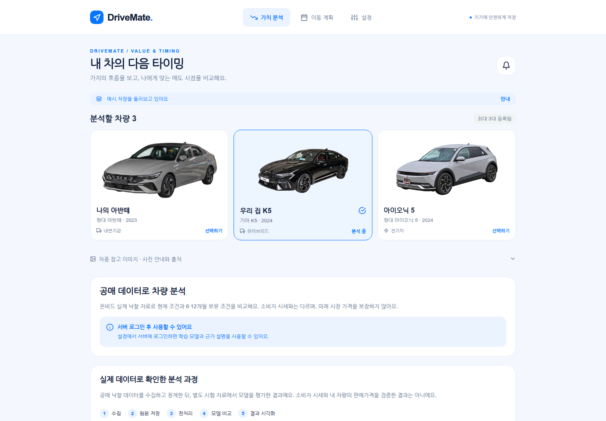
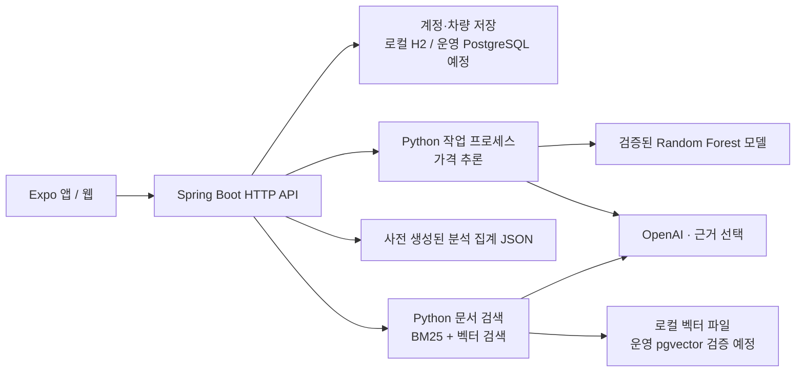
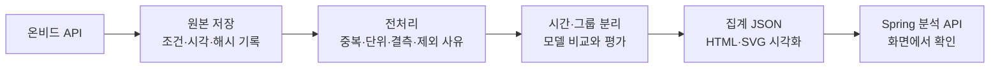

# DriveMate · make_drive_mate

차량 정보를 등록하고 **현재 조건의 공매 참고 가격, 향후 보유 시나리오, 판단 근거**를 함께 확인하는 차량 관리·분석 프로젝트입니다. 차량 가격은 ML이 계산하고, GPT는 검증된 결과와 검색된 문서의 근거를 선택해 설명합니다.

**현재 기본 백엔드는 Spring Boot입니다.** Python은 데이터 수집·전처리·학습·추론·문서 검색 작업을 담당합니다. `backend/app/`에 남아 있는 FastAPI 코드는 이전 구현이며 기본 실행 서버가 아닙니다.

[팀 작업 분담](docs/TEAM-HANDOFF.md) · [전체 구조](docs/ARCHITECTURE.md) · [문서 수정 위치](docs/DOCUMENT-CHANGE-MAP.md) · [GitHub Actions](https://github.com/cloud-project-mobility/make_drive_mate/actions)

## 현재 구현 상태

기준일: **2026-11-04**. 공개 저장소의 소스와 별도로 준비한 비공개 데이터가 필요한 기능을 구분합니다.

| 영역          | 구현·검증 상태                                                                    | 실행 조건·남은 일                                                                                                           |
| ------------- | --------------------------------------------------------------------------------- | --------------------------------------------------------------------------------------------------------------------------- |
| 프런트엔드    | React Native / Expo / TypeScript. 차량 관리, 가치 비교, 분석 집계, 문서 검색 화면 | 웹 검증 완료. 모바일 실기기 검증은 별도                                                                                     |
| Spring API    | Spring Boot 4.1.2 / Java 17 / JDBC. 로그인, 계정별 차량·백업, 가격·분석·문서 API  | 로컬 H2 사용. 운영 PostgreSQL 연결 검증 필요                                                                                |
| 가격 모델     | 온비드 정제 2,197행 기반 Random Forest. 실제 로컬 추론 확인                       | 모델·데이터 파일은 공개 저장소에서 제외                                                                                     |
| GPT 설명      | 검증된 사실·사례에서 설명 근거 선택. 실제 API 연결 확인                           | OpenAI 키와 서버 설정 필요. GPT가 가격을 생성하지 않음                                                                      |
| 문서 RAG      | 6개 문서·83개 청크. BM25 + 벡터 검색 + 출처 표시                                  | 로컬 검색 확인. 운영 pgvector/RDS 적재·검색은 미검증                                                                        |
| 데이터 사이클 | 수집 → 저장 → 전처리 → 모델 비교·평가 → 집계·시각화 CLI                           | SQS worker 코드 준비. AWS 정기 실행은 미가동                                                                                |
| CI            | Spring·Python·웹 검사와 코드 배포 산출물 생성 성공                                | [검증된 실행 기록](https://github.com/cloud-project-mobility/make_drive_mate/actions/runs/41794335643), 코드 기준 `ede6d2c` |
| AWS / CD      | 인프라·Nginx·수동 배포 워크플로 작성                                              | **공개 서비스 미배포, CD 미활성**. 실행 중인 DriveMate EC2·RDS 없음                                                         |

공개 clone에는 **소스·테스트·기술 문서·코드 전용 노트북**이 있습니다. API 키, 계정 DB, 원시·정제 데이터, 학습 모델, 원본 Word/PPT, 문서 본문·검색 인덱스, 데이터가 내장된 Colab 사본은 포함하지 않습니다.

## 사용자 흐름과 기능

1. 차량 정보를 등록하거나 로그인 없이 예시 차량으로 화면을 둘러봅니다.
2. 서버 로그인 후 차량 조건을 입력해 공매 데이터 기반 현재 참고 가격과 6·12개월 보유 시나리오를 비교합니다.
3. 학습 범위를 벗어나면 가격 제공을 유보하고, 데이터가 적으면 경고를 표시합니다.
4. 검증된 모델 결과·유사 공매 사례·한계를 확인하고, 선택적으로 GPT 근거 설명을 요청합니다.
5. 데이터 분석 화면에서 수집·제외·정제 건수와 모델 평가를 확인합니다. 문서 검색은 사전 허용 계정에만 제공합니다.

서버 없이 사용하는 **가치 분석 예시**는 별도 합성 계산입니다. 0·6·12·24개월의 가치·입력 유지비·목표 매도가·최소 보유기간을 비교합니다. 최근 매입견적을 입력할 수 있지만 미래 변화는 가정이며, 표시된 가정폭은 통계적 신뢰구간이 아닙니다.

기존 차량 관리 기능도 유지합니다. 차량 최대 3대, 소모품 기록, 이동 계획, 사용자가 시작하는 GPS 주행 기록, 로컬 알림, 기기 저장·JSON 백업, 계정별 서버 백업을 제공합니다. 지도·캘린더 외부 연동의 기본 모드는 명시적인 예시 데이터입니다.

웹의 **이동 계획 → 실시간 위치**에서는 로그인한 같은 계정의 기기를 연결하고, 내 기기 위치 전송을 직접 시작·중지할 수 있습니다. Spring WebSocket으로 최근 위치만 중계하며 좌표를 DB나 이동 경로 이력에 저장하지 않습니다. 카카오 지도는 별도로 연결한 경우에만 불러옵니다. 휴대전화·PC의 위치이며 현대 차량 자체의 위치 조회가 아닙니다. [위치 연결](docs/REALTIME-LOCATION.md) · [웹 지도 설정](docs/LIVE-MAP.md)

### 최신 UI

파란색 테마와 배경을 제거한 실제 차량 참고 이미지를 적용한 현재 화면입니다. 사진은 차종을 설명하는 이미지이며 사용자가 등록한 차량 자체의 사진이나 사고·상태 증빙이 아닙니다. 아래 화면은 예시 차량을 선택한 로그인 전 상태로, 실제 공매 분석에는 서버 로그인이 필요합니다.



[모바일 화면](docs/evidence/2026-11-04/current-ui-mobile.png) · [차량 사진 출처·이용 조건](docs/VEHICLE-PHOTOS.md)

## 시스템 구조



Spring이 인증·접근 권한·입력 검증·요청 한도를 처리하고, 고정된 Python 작업을 제한된 프로세스로 호출합니다. 프런트엔드가 Python HTTP 서버나 OpenAI에 직접 연결하는 구조가 아닙니다.

| 구성           | 기술                                                                     |
| -------------- | ------------------------------------------------------------------------ |
| 앱·웹          | Expo SDK 57, React Native 0.86, React 19, TypeScript                     |
| API·계정 저장  | Java 17, Spring Boot 4.1.2, JDBC, H2 / PostgreSQL                        |
| 분석·학습      | Python 3.12, scikit-learn, Random Forest / Extra Trees 비교              |
| 설명·검색      | GPT `gpt-6-astra`, `text-embedding-3-small` 1,536차원, BM25 + RRF        |
| 운영 구성 코드 | CloudFront → EC2 Nginx → Spring, RDS, S3, SQS, EventBridge               |
| 검증·배포 설정 | GitHub Actions, JUnit, Python unittest, Playwright, OIDC + SSM 배포 설정 |

## 로컬 실행

아래 명령은 **Linux / WSL의 Bash**에서 저장소 루트를 기준으로 실행합니다. Node.js 24와 npm, 백엔드 실행에는 JDK 17 이상이 필요합니다. Maven 래퍼는 처음 실행할 때 배포본을 내려받고 체크섬을 확인합니다.

### 1. 소스 설치와 예시 화면

```bash
git clone https://github.com/cloud-project-mobility/make_drive_mate.git
cd make_drive_mate
npm ci
npm run web
```

브라우저에서 **예시 차량으로 둘러보기 → 가치 분석**을 선택합니다. 이 경로에는 API 키·학습 모델·서버 계정이 필요하지 않습니다. `npm start`, `npm run android`, macOS의 `npm run ios`로 모바일 개발을 시작할 수도 있습니다.

### 2. Spring 계정·차량 API까지 실행

별도 터미널 A에서:

```bash
npm run build:backend
npm run backend
```

API는 `http://127.0.0.1:18085`에서 실행됩니다. 기본값은 로컬 H2와 외부 제공자 `mock` 모드입니다.

별도 터미널 B의 같은 저장소에서 실행합니다. 앞서 웹 서버를 켜 두었다면 포트가 겹치지 않도록 종료한 뒤 실행하세요.

```bash
npm run web -- --localhost --port 8081
```

`http://127.0.0.1:8081`에서 **설정 → 서버 연결 확인 → 로컬 테스트 계정 만들기**로 진행합니다. 로컬 HTTP 웹의 API 기본 주소는 `http://127.0.0.1:18085`입니다. `http://127.0.0.1:18085/api/v1/health`에서도 Spring 상태를 확인할 수 있습니다.

HTTPS 웹은 현재 웹 주소를 API 기본값으로 사용합니다. 별도 API 주소가 필요하면 빌드 시 `EXPO_PUBLIC_API_BASE_URL`을 설정하고 서버의 CORS 허용 주소도 맞춥니다. 이 공개 변수에는 API 주소만 넣습니다. 모바일에서 `127.0.0.1`은 휴대전화 자신이므로 기기에서 접근할 수 있는 서버 주소가 필요합니다.

웹 위치 권한은 HTTPS 또는 localhost에서 사용합니다. 카카오 지도에는 JavaScript SDK용 공개 키 `EXPO_PUBLIC_KAKAO_JAVASCRIPT_KEY`와 실제 웹 주소의 도메인 등록이 필요합니다. GitHub Actions도 같은 이름의 저장소 **변수**를 사용합니다. OpenAI·온비드·카카오 REST·현대 Client Secret은 공개 변수에 넣지 않습니다.

### 3. 실제 ML·GPT·RAG 사용

기본 서버가 켜졌다는 사실만으로 실제 모델과 문서 검색이 준비되지는 않습니다.

| 기능             | 추가 준비                                                                                 |
| ---------------- | ----------------------------------------------------------------------------------------- |
| 온비드 신규 수집 | 승인된 API 키. [수집·전처리 안내](docs/ONBID-DATA.md)                                     |
| 가격 추론        | Python 환경, ML 의존성, 검증된 모델 파일·해시·서버 경로. [모델 안내](docs/ONBID-MODEL.md) |
| 분석 집계        | 성공한 사이클의 집계 파일. [반복 분석 안내](docs/CYCLE.md)                                |
| GPT 설명         | 서버의 OpenAI 키와 설명 허용 설정                                                         |
| 문서 검색        | 승인·가림 처리한 문서, 임베딩 인덱스, OpenAI 키, 허용 계정. [RAG 안내](docs/RAG.md)       |

기존 비공개 자료를 준비한 환경의 실행 절차는 [팀 인수 안내](docs/TEAM-HANDOFF.md)를 따릅니다. `scripts/run-local-backend.py`는 해당 자료와 정해진 경로가 이미 있는 환경용이며, 새 clone만으로 실행하는 시작 명령이 아닙니다. 키와 개인정보는 Git에 올리지 않습니다.

## 데이터 수집·분석 사이클



`backend/scripts/onbid_pipeline.py`가 사이클을 실행합니다. 실패한 실행이 마지막 성공 결과를 덮어쓰지 않으며, 새 후보 모델을 서비스 모델로 자동 교체하지 않습니다. EventBridge·SQS 정기 실행은 배포 후 검증할 구성입니다.

현재 모델 데이터의 **개찰일 기준 조회 기간은 2025-11-04~2026-11-03**이며 실제 수집일은 2026-11-04입니다. 원본 5,268행 → 승용 범주 2,284행 → 정제 2,197행이며, 폐차·고철·점검용·다수 차량 묶음과 단위가 불명확한 자료를 구분했습니다.

추가로 받은 온비드 목록 **54,815건을 정제해 14,867건**을 확보했습니다. 기존 기준본과 동일한 사건은 2,187건이고 새 사건은 12,680건입니다. 원본 해시·제외 사유·반복 물건 그룹·민감 차량 속성을 검사했으며, 로컬 내보내기 파일의 가져오기 완료와 원 수집의 완전성은 구분합니다. 이 자료로 후보를 학습·평가했지만 **서비스 모델과 RAG 인덱스는 기존 검증본을 유지합니다**. [가져오기·전처리](docs/ONBID-DATA.md) · [후보 평가와 한계](docs/ONBID-MODEL-CANDIDATE-v3.md)

## 모델과 성능 평가

중앙값 기준 모델, Random Forest, Extra Trees를 비교해 검증 구간 MAE로 **로그 가격 Random Forest**를 선택했습니다. 시간순 훈련·검증·구간 보정·최종 시험을 나누고, 물건관리번호 기준 그룹이 시간 경계에 걸치면 제외했습니다. 물건관리번호만으로 모든 물리 차량의 중복을 식별할 수 있는 것은 아닙니다.

| 평가 범위                                  |  표본 |        MAE | 해석                            |
| ------------------------------------------ | ----: | ---------: | ------------------------------- |
| 전체 최종 시험                             | 341건 | 236.15만원 | 전체 시험 결과                  |
| 사전에 정한 가격 제공 조건에 맞는 부분집합 | 262건 | 134.74만원 | 제공률 76.83%, 나머지 79건 유보 |

조건부 결과는 전체 성능을 대신하지 않습니다. 예측 대상은 **공매 낙찰가격**이며 소비자 중고차 시세·확정 매입견적과 다릅니다. 미래 표시는 시장 조건을 고정하고 차령·주행거리를 바꾼 시나리오로, 실제 미래 시장가격이나 최적 매도일을 검증한 결과가 아닙니다. 사고·정비·세대·트림 정보와 보유비용 데이터도 충분하지 않습니다.

상세 분할·오차·제공 조건은 [모델 문서](docs/ONBID-MODEL.md), 재현 코드는 [코드 전용 노트북](notebooks/README.md)에 있습니다. 기존 원본 부스팅 노트북의 점수를 현재 차량 모델 성능으로 사용하지 않습니다.

## RAG 구성과 문서 사용

문서 검색은 가격 모델과 분리되어 있습니다. 현재 6개 문서는 PoC·중간보고서·발표자료 사본, 온비드 공식 목록·상세 설명, 검증된 모델 평가 기록입니다.

- 개인정보를 가린 본문을 `text-embedding-3-small`로 임베딩합니다.
- 한국어 BM25와 코사인 검색 결과를 RRF로 결합하고 중복 상위 절을 정리합니다.
- 문서명·절/문단·슬라이드와 `계획 / 보고 / 공식 / 코드 검증` 상태를 보존합니다.
- GPT는 검색된 출처 ID를 선택합니다. 근거 부족은 보류하고, LLM 실패는 검색 결과만 제공하는 상태로 구분합니다.
- 현재 로컬은 `DRIVEMATE_RAG_BACKEND=local`을 명시합니다. 운영 기본값은 `pgvector`이며 실제 RDS 검증은 남아 있습니다.

추가 자료는 용도에 맞게 분리합니다. 규정·설명문은 RAG 후보, 가격표·잔가율은 단위와 조건이 보존되는 구조화 조회 후보, 공매 낙찰 사례는 정제 후 모델 학습 후보입니다. 행정상 시가표준액을 시장가격으로 취급하거나 모든 숫자표를 문서 검색에만 맡기지 않습니다.

작은 확인용 질문 10개에서 Recall@3은 0.90이었습니다. 개발자가 만든 평가이며 일반 정확도나 환각 방지를 보장하지 않습니다. 검색만 요청해도 질문 임베딩 비용이 발생합니다. [검색·권한·평가 상세](docs/RAG.md)를 확인하세요.

## 테스트와 CI/CD

```bash
npm run check
npm run check:backend
npm run build:backend
npx playwright install chromium
EXPO_NO_DOTENV=1 npm run export:web
DRIVEMATE_WEB_STATIC=1 npm run test:integrated -- tests/e2e/valuation.spec.ts tests/e2e/onbid.spec.ts tests/e2e/backend.spec.ts
```

통합 검사는 별도 H2 메모리 DB와 Spring `18086`, 웹 `18087`을 사용합니다. ML/RAG 화면의 합성 응답 검사는 실제 모델 성능이나 유료 API 호출 검증을 의미하지 않습니다. Python 의존성과 검사는 [CI 워크플로](.github/workflows/ci.yml)에 고정되어 있습니다.

기록된 기준 검증은 Spring 47개, 프런트 도메인 90개, Python 54개, 선택 브라우저 시나리오 34개 통과입니다. [기준 커밋의 원격 CI](https://github.com/cloud-project-mobility/make_drive_mate/actions/runs/41794335643)는 `spring`, `python`, `web`, `release`가 모두 성공했습니다. 새 커밋 결과는 [Actions](https://github.com/cloud-project-mobility/make_drive_mate/actions)에서 확인합니다.

현재 CI는 **웹 export**, Spring JAR, 코드 전용 배포 ZIP을 만듭니다. Android/iOS 실기기 시험이나 서명된 APK/IPA 배포를 수행하지 않습니다. CD는 성공한 main CI 산출물을 지정해 OIDC·SSM으로 배포하는 수동 워크플로이며, 현재 AWS 대상 서버가 없어 활성화하지 않았습니다. [CI/CD 안내](docs/CICD.md)와 [AWS 실제 상태](infra/aws/DEPLOYMENT-STATUS.md)를 참고하세요.

## 팀 작업과 문서

| 순서             | 담당 범위                                                      | 완료 기준                                 |
| ---------------- | -------------------------------------------------------------- | ----------------------------------------- |
| 1. 디버깅        | 설치 재현, 로그인·차량·분석 회귀, 오류·권한·단위 검사          | 재현 가능한 버그 목록과 수정 후 검증      |
| 2. 백엔드·데이터 | Spring API 계약, 추가 데이터 전처리, PostgreSQL/pgvector, 배포 | API 계약·모델 평가·실제 저장 및 배포 검증 |
| 3. 프런트엔드    | API 연결, 결과·유보·출처·오류 표시, 반응형·접근성              | 실제 응답과 화면 일치, 시연 흐름 검증     |

- [팀 인수·분담 안내](docs/TEAM-HANDOFF.md): 담당별 파일, 실행 순서, 남은 작업.
- [원본 문서 수정 위치](docs/DOCUMENT-CHANGE-MAP.md): PoC·중간보고서·PPT·기존 노트북의 교체 항목.
- [문서 수정 프롬프트](docs/DOCUMENT-UPDATE-PROMPT.md): 원본 양식을 유지한 최신 구현 반영 지침.
- [인수 메모](docs/DELIVERY-NOTES.md): 실제 검증 범위, 로컬 실행과 AWS 상태.

원본 Word·PowerPoint와 데이터가 내장된 노트북은 비공개 팀 폴더에서 관리합니다. 원본 문서 자체의 수정은 아직 완료하지 않았습니다.

## 저장소 구조

```text
src/app/          Expo Router 화면
src/screens/      차량·가치 분석·문서 검색 등 사용자 화면
src/components/   공통 UI·테마·차량 이미지
src/domain/       상태 전이·입력 검증·계산·단위 테스트
src/state/        기기 저장·복구·상태 관리
src/services/     API 연결·위치·알림·백업
backend-spring/   현재 Spring HTTP API·계정·JDBC·외부 연동
backend/scripts/  온비드 수집·전처리·모델·분석·RAG 작업
backend/app/      이전 FastAPI 구현, 기본 실행 경로에서 제외
notebooks/        데이터 없는 코드 전용 모델 비교 노트북
scripts/          로컬 실행·웹 제공·통합 검증 도구
tests/e2e/        브라우저 통합 검사
infra/aws/        인프라·Nginx·배포·SQS worker 설정
.github/workflows/ CI 및 수동 CD
docs/             설계·검증·데이터·팀 인수 문서
```

## 기존 기능의 제한과 출처

Kakao·Google 연동 경계는 구현했으나 실제 키·실계정 검증은 미완료이며 현대 실차 연결은 미지원입니다. 계정 이메일 확인·비밀번호 복구, 백업 자동 병합은 제공하지 않습니다. 이전 Python 서버의 계정·토큰 자동 이전도 지원하지 않습니다. [외부 연동](backend-spring/PROVIDERS.md)과 [연동 범위](docs/INTEGRATION.md)를 참고하세요.

GPS는 앱이 활성화된 동안 측정하며 화면 잠금·다른 앱 전환 시 멈춥니다. 지도 화면은 경로 개요이고 실제 지도·교통은 외부 지도 앱에서 확인합니다. 기기 저장은 암호화된 클라우드 보관함이 아니며 삭제에 대비해 사용자가 백업해야 합니다.

차량 일러스트는 사용자 제공 Penpot 원안에서 가져왔고 출처는 [UX 조사](docs/UX-AUDIT.md)에 기록했습니다. 추가 차량 사진은 [사진 출처·이용 조건](docs/VEHICLE-PHOTOS.md)을 따릅니다. 자동 검사와 구현 점검을 실제 사용자 연구 또는 모바일 실기기 검증으로 표현하지 않습니다.
