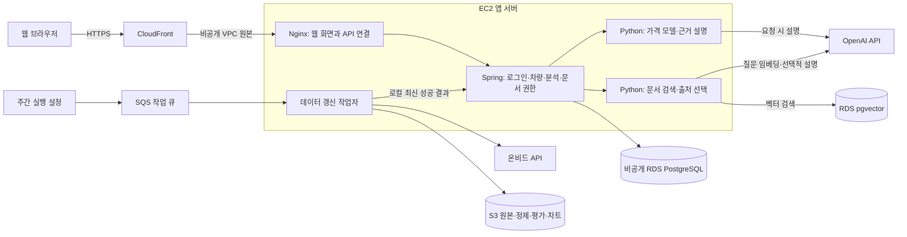
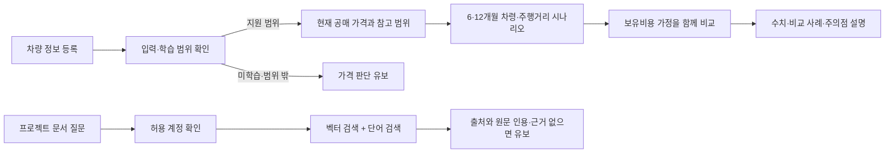
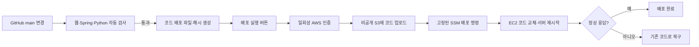

# DriveMate 서비스와 배포 흐름

이 그림은 구현된 코드와 배포 설정의 구조다. 실제 클라우드 가동·CI/CD 활성화 여부는 [인수 메모](DELIVERY-NOTES.md)의 확인표를 기준으로 한다.

Nginx는 EC2 안에서 실행되는 웹 서버다. Spring은 계정과 차량 정보를 처리하고, 가격 모델 및 문서 검색은 같은 EC2의 제한된 Python 작업으로 실행한다. pgvector는 별도 서버가 아니라 RDS PostgreSQL에 설치하는 벡터 검색 기능이다. 작업자는 분석 파일을 S3에 모두 보관한 다음 로컬 최신 성공 결과를 갱신하고, Spring은 그 결과를 읽는다.

예측의 기준은 공매 낙찰가다. 미래 값은 시장 조건을 고정하고 차령과 주행거리를 바꾸는 시나리오이며, 미래 소비자 시세를 검증한 결과는 아니다. 문서 검색은 가격 계산을 대체하지 않는다.

배포는 승인된 main 검사 결과를 지정해서 실행한다. API 키·개인 문서·학습 데이터·모델은 코드 배포 파일에 넣지 않는다. 코드 교체 때 짧은 중단이 있으며, 의존성 변경과 데이터베이스 구조 변경은 별도 검증이 필요하다.

무료 플랜 유지 요청에 따라 RDS는 단일 서버와 1일 백업으로 구성한다. 다중 가용 영역 자동 전환 구성은 아니다. 주간 실행은 운영 환경에서 첫 데이터 갱신을 검증한 후 활성화한다.
