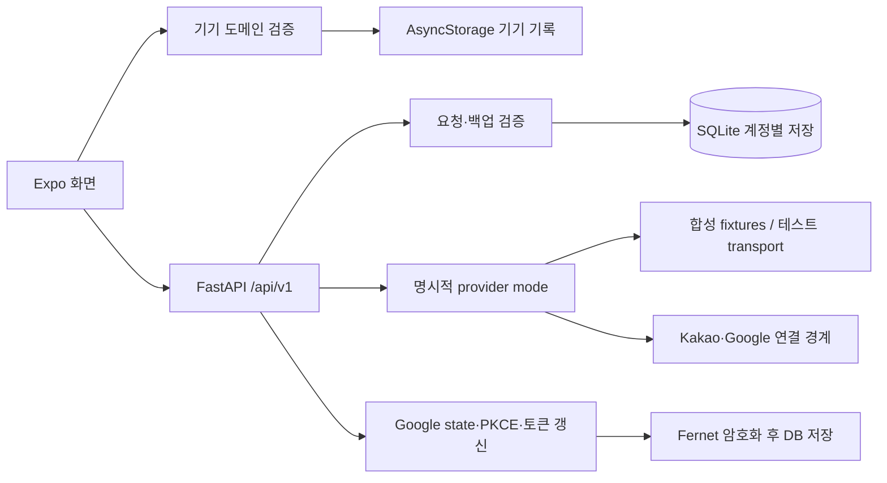

# 백엔드 인계 · 과제 시연 기준

이 문서는 기존 DriveMate 화면·도메인 규칙과 세 API 실험 저장소에서 확인한 계약을 통합 구현에 연결합니다. [실행·시연 명령](../backend/README.md), [전체 검증 기록](VALIDATION.md), [연동 상태](INTEGRATION.md)를 함께 사용하세요. 이번 검증은 실제 API 키와 실제 공급자 호출 없이 진행합니다. mock 통과, 서버 구현, 운영 연결 검증은 각각 구분합니다.

## 요구사항과 구현 근거

| 과제 흐름                 | 구현과 확인 지점                                                                                                                    | 남은 범위                                                     |
| ------------------------- | ----------------------------------------------------------------------------------------------------------------------------------- | ------------------------------------------------------------- |
| 차량·주행·점검·계획 관리  | 기존 `src/domain/` 검증을 유지하고 서버도 동일 백업 형식과 차량 참조를 검증                                                         | 실제 차종별 소모품 정책의 근거와 실차 검증                    |
| 계정별 서버 저장          | 로컬 이메일/비밀번호 계정, 만료·로그아웃·계정 삭제 API, SQLite 스냅샷과 버전 충돌 처리                                              | 이메일 확인·비밀번호 재설정은 제공하지 않음                   |
| 캘린더 일정으로 이동 계획 | 서버 목록 조회 후 사용자가 선택해 계획에 복사. 종일 일정은 시간 미정, 장소 누락은 직접 입력. 반복 일정 조회·페이지 처리·시간대 검증 | 실제 Google 동의와 데이터 조회, 원본 변경·취소의 지속 동기화  |
| 장소 검색·출발 시각 계산  | WGS84 경도/위도 선택, 공급자 거리(m)·시간(s) 보존, 도착 시각에서 운전·도보·여유 시간 차감                                           | 실제 Kakao 호출·도로 지도 SDK 표시·실시간 교통 검증           |
| 오래된 경로 구분          | API는 계산 시각과 5분 후 만료 시각을 제공. UI에서 사용자가 재계산                                                                   | 5분마다 자동 조회하는 기능은 없음                             |
| 차량 상태 확인            | 명시적 합성 예시 상태, 원본 거리 단위·제조사 시각·서버 수신 시각 구분. 기존 누적거리와 자동 합산하지 않음                           | 현대 실차 OAuth·소유 확인·데이터 계약·실시간 최신성           |
| 주행 기록·출발 알림       | 기존 전경 GPS, 중복 누적 방지, 차량·계획 삭제 및 복원 시 알림 정리 규칙 유지                                                        | Android/iOS 기기별 권한·알림·GPS 시연. 백그라운드 기록 미지원 |

이 표의 완료 기준은 소스와 실행 결과로 확인할 수 있는 기능입니다. “실서비스 연결 완료”, “실차 최신 상태”, “실시간 내장 지도”를 mock 결과로 발표하지 않습니다.

추가 견고성 루프에서는 선택한 장소 좌표와 경로 출처·계산/만료 시각을 계획에 보존하고, 지도 앱에도 해당 좌표를 전달합니다. 만료한 저장 경로는 다시 확인하도록 안내합니다. 캘린더에서 가져온 정확한 시각을 유지하며 DST로 같은 현지 시각이 두 번 발생하는 수동 입력에는 UTC 시차 선택을 제공합니다. 계정·화면 해제·주행·기기 데이터 변경이 비동기 복원과 겹치면 적용 직전 다시 검사합니다. 상세 근거는 [추가 루프 기록](robustness/2026-10-28/summary.md)에 있습니다.

## 구조와 저장 규칙

서버는 Python 3.11+, FastAPI, 동기식 httpx, SQLite를 사용합니다. `uv.lock`으로 의존성을 고정합니다. 계정·세션·백업·OAuth 상태를 사용자 ID로 분리하고 외래 키 삭제 연쇄를 적용합니다. SQLite 트랜잭션에서 백업 버전을 확인하므로 서로 다른 내용의 동시 저장이 이전 데이터를 조용히 덮어쓰지 않습니다.

비밀번호는 계정별 salt와 scrypt로 해시하며, 세션은 무작위 토큰을 발급하고 DB에는 토큰 해시를 저장합니다. 기본 세션 유효기간은 12시간입니다. 프런트엔드는 Bearer 토큰과 비밀번호를 AsyncStorage에 저장하지 않습니다. 로컬 계정은 Google 로그인과 별개이며 이메일 소유 확인 기능은 없습니다.

스냅샷은 기존 앱 `version: 1` 데이터의 차량·계획·완료 주행·점검·설정을 담는 JSON입니다. 서버 DB에 저장되는 스냅샷 전체를 암호화하는 기능은 없습니다. Google access/refresh token과 PKCE verifier는 별도 서버 키를 사용해 Fernet으로 암호화합니다. DB와 암호화 키는 Git에 넣지 않습니다.

백업 흐름은 **조회 → 버전·내용 확인 → 저장 또는 복원 확인**입니다. `PUT /state`는 `expected_revision`과 `state`를 받습니다. 새 계정의 revision은 0입니다. 다른 내용의 오래된 revision은 `revision_conflict`/409, 동일 내용 재전송은 같은 revision입니다. 진행 중인 `activeTrip`은 서버 업로드 대상이 아닙니다. 기기 복원은 기존 출발 알림 취소와 도메인 검증을 거칩니다. 로그인 전환은 기기 데이터를 자동 삭제하거나 다른 계정 데이터로 교체하지 않습니다.

Google 연결은 **사용자 로그인 → 연결 준비 → 외부 동의 → 서버 callback** 흐름입니다. callback state는 계정에 연결되고 10분 동안 한 번만 사용할 수 있으며 PKCE S256을 적용합니다. 요청 권한은 `calendar.events.readonly` 하나입니다. 토큰은 서버에만 저장하고 만료 시 갱신하며, 동의 철회 오류는 재연결로 처리합니다. 연결 해제는 로컬 토큰을 삭제하고 Google 철회를 시도하며, 공급자 철회 성공을 확인하지 못하면 그 사실을 따로 반환합니다. Calendar 연결은 Google 계정으로 DriveMate에 로그인하는 기능이 아닙니다.

## API 계약

기본 주소는 `http://127.0.0.1:18085/api/v1`입니다. 공개 항목 외에는 로컬 계정의 `Authorization: Bearer <session>`이 필요합니다. 입력 실패 응답은 비밀번호·토큰·공급자 오류 본문을 그대로 반환하지 않습니다.

| 메서드 · 경로                         | 입력 또는 결과                                                                        | 접근                   |
| ------------------------------------- | ------------------------------------------------------------------------------------- | ---------------------- |
| `GET /health`                         | DB 접근 확인, provider mode, DB schema version                                        | 공개                   |
| `POST /auth/register`                 | `email`, `password` → 세션·사용자·만료 시각                                           | 공개, 요청 제한        |
| `POST /auth/login`                    | `email`, `password` → 세션·사용자·만료 시각                                           | 공개, 요청 제한        |
| `GET /auth/me`                        | 현재 사용자                                                                           | 세션                   |
| `POST /auth/logout`                   | 현재 세션 폐기                                                                        | 세션 토큰              |
| `DELETE /account`                     | 계정과 서버 기록 삭제, Google 연결 해제 시도                                          | 세션                   |
| `GET /state`                          | `revision`, `state`, `updated_at`                                                     | 세션                   |
| `PUT /state`                          | `expected_revision`, `state` → 저장된 스냅샷                                          | 세션                   |
| `GET /integrations`                   | 공급자 모드·설정·연결 여부, 실연동 검증 여부                                          | 세션                   |
| `POST /integrations/google/authorize` | Google 동의 URL과 유효기간                                                            | 세션, live 설정 필요   |
| `GET /integrations/google/callback`   | `state`, `code` 또는 `error` → 연결 결과                                              | 일회용 state           |
| `DELETE /integrations/google`         | 로컬 연결 삭제와 `provider_revoked` 결과                                              | 세션                   |
| `GET /places?q=서울역`                | `source`, `places`의 이름·주소·경도·위도                                              | 세션                   |
| `POST /routes`                        | 출발·도착 좌표, `arrival_at`, `walk_minutes`, `buffer_minutes` → m/s 경로와 출발 시각 | 세션                   |
| `GET /calendar/events`                | 선택적 `time_min`, `time_max` → 정규화 일정 목록. 시간대 포함, 최대 90일              | 세션                   |
| `GET /vehicles/status?powertrain=EV`  | `ICE`·`HYB`·`EV`의 명시적 예시 상태                                                   | 세션, 현대 live 미지원 |

서버의 `/docs`와 `/openapi.json`에서 정확한 요청 스키마를 확인할 수 있습니다. `KakaoProvider.geocode()`도 구현·검증하지만 별도 HTTP geocode 엔드포인트나 UI를 제공한다고 주장하지 않습니다.

## 공급자 모드와 데이터 출처

| 설정           | 동작                                                                                                                   |
| -------------- | ---------------------------------------------------------------------------------------------------------------------- |
| `mock`         | 기본값. 외부 API 키 없이 직접 만든 장소·경로·다음 날 일정·차량 상태를 반환. 응답에 `source: mock` 표시                 |
| `disconnected` | 로컬 계정·백업은 사용 가능. 외부 데이터 요청은 연결되지 않았다는 오류                                                  |
| `live`         | 명시적으로 제공한 서버 설정과 사용자 동의를 사용. 누락된 설정은 오류이며 mock으로 대체하지 않음. 현대는 계속 사용 불가 |

실제 키를 쓰지 않는 테스트에서는 주입한 HTTP transport의 결과도 `mock`으로 표시합니다. HTTP 200과 Kakao `result_code == 0`은 따로 검사하며 실패 시 직선 거리·임의 ETA를 만들지 않습니다. 요약 소요 시간과 구간 합계가 다르면 각각 보존합니다. 임의 호스트로 키를 보내거나 리다이렉트를 따라가지 않습니다.

Calendar는 `nextPageToken`이 끝날 때까지 읽습니다. 빈 페이지도 토큰이 있으면 계속하고, 토큰 반복·페이지 상한·잘못된 일정은 부분 성공으로 숨기지 않습니다. 종일 `end_date`는 제외 종료일입니다. 시간대가 있는 시각과 날짜만 있는 일정을 섞지 않고, 장소가 없으면 `null`로 유지합니다. 취소된 일정은 목록에서 제외합니다. 선택해 저장한 로컬 계획은 원본 캘린더와 지속 동기화되지 않습니다.

현대 상태는 공식 성공 예시의 필드 계약을 참고해 새로 만든 합성 데이터입니다. 과거 실험의 공개 Sample 성공은 실차 접근 검증이 아닙니다. 제조사 원본 timestamp의 시간대가 확인되지 않았으므로 `observed_at`은 `null`이고 원문·시간대 미확인 값과 UTC 수신 시각을 별도로 보존합니다. 경고등 한 항목이 꺼져 있다는 값으로 차량 전체가 정상이라고 판단하지 않습니다.

## 검증과 발표 범위

Python 테스트는 외부 소켓 연결을 차단하며 API 계정 분리·지속성·충돌·검증 오류와 공급자 타임아웃·429·잘못된 JSON·OAuth 토큰 경계를 확인합니다. Playwright 연동 테스트는 실행 중인 mock FastAPI에 실제 로컬 HTTP 요청을 보내 저장·복원·일정 선택·경로 적용을 확인합니다. `npm run test:integrated`는 18086 포트와 임시 DB를 사용하는 검사 서버를 자동 시작·정리합니다. 프런트엔드 도메인 테스트와 타입 검사, 웹 export도 별도로 수행합니다. CI는 Python 3.11·3.14와 branch coverage 90% 이상을 확인합니다. 명령과 건너뛰기 조건은 [실행 문서](../backend/README.md#검증-명령)에 있습니다.

실제 Google/Kakao 권한, 현대 실차, 네이티브 기기 GPS·알림, EAS 서명·업로드 및 앱스토어 배포는 이 오프라인 검증의 성공 범위에 들어가지 않습니다. 제출 자료에는 [검증 기록](VALIDATION.md)의 실제 실행 결과와 남은 항목을 그대로 사용합니다.

계약 출처: 조직 저장소 [Kakao 실험](https://github.com/cloud-project-mobility/kakao-map-api-experiments), [Google Calendar 실험](https://github.com/cloud-project-mobility/google-calender-iljung-api-experiment), [현대 실험](https://github.com/cloud-project-mobility/hyundai_devloper_api_experiments). Google 토큰 교환·갱신은 [공식 웹 서버 OAuth 문서](https://developers.google.com/identity/protocols/oauth2/web-server), PKCE 형식은 [공식 PKCE 설명](https://developers.google.com/identity/protocols/oauth2/native-app)을 근거로 구현합니다. 소스별 유래는 각 provider 모듈에도 기록했습니다.

## 추후 실제 연동을 위해 한 번에 준비할 항목

현재는 아래 값을 요청하거나 읽지 않아도 과제의 mock 시연·검사를 실행할 수 있습니다. 실서비스 연결 단계에서만 서버에 설정하며 비밀값을 채팅·앱 화면·Git에 올리지 않습니다. 빈 목록은 [backend/.env.example](../backend/.env.example)에 있습니다. 이 파일은 자동으로 로드되지 않으며, 빈 설정 전체를 그대로 export하면 기본값을 덮어쓸 수 있으므로 사용할 항목만 명시적으로 설정합니다.

| 대상            | 서버 설정·준비 사항                                                                                                 | 실제 확인할 내용                                                                            |
| --------------- | ------------------------------------------------------------------------------------------------------------------- | ------------------------------------------------------------------------------------------- |
| 실행 모드       | `DRIVEMATE_PROVIDER_MODE=live`                                                                                      | 설정 누락 시 차단되는지, mock과 UI 표시가 구분되는지                                        |
| Kakao           | `DRIVEMATE_KAKAO_REST_KEY`, 별도 키를 쓰는 경우만 `DRIVEMATE_KAKAO_MOBILITY_KEY`                                    | Local 검색·길찾기 사용 권한, 호출 제한 및 허용 조건. Mobility 키 미지정 시 REST 키 사용     |
| Google          | `DRIVEMATE_GOOGLE_CLIENT_ID`, `DRIVEMATE_GOOGLE_CLIENT_SECRET`, `DRIVEMATE_GOOGLE_REDIRECT_URI`                     | 웹 OAuth 클라이언트, Calendar API 사용 설정, 동의 화면·테스트 사용자, 일정 읽기 권한        |
| Google callback | 로컬 예: `http://127.0.0.1:18085/api/v1/integrations/google/callback`을 콘솔과 서버에 정확히 동일하게 등록          | 호스트·포트·경로 일치, 실제 동의·거절·만료·철회 후 재연결                                   |
| 서버 토큰 보관  | `DRIVEMATE_TOKEN_ENCRYPTION_KEY`: 서버 관리자가 만든 Fernet 키                                                      | 재시작 후에도 같은 키 유지. 키 분실·교체 시 기존 연결 재동의 필요                           |
| 웹 접근 주소    | 필요할 때 `DRIVEMATE_CORS_ORIGINS`에 쉼표로 구분한 정확한 origin                                                    | 기본 허용은 localhost/127.0.0.1의 8081·19006 포트. 공용 서버는 HTTPS 운영 구성 별도         |
| 현대 실차       | 키 입력 항목을 만들어 두지 않음. 서비스 계약·차량 소유 및 사용자 동의·OAuth·조회 권한·보관 조건 확인 후 어댑터 추가 | timestamp 시간대, 단위, 갱신 지연, 동의 철회·삭제 정책 및 실차 응답. 현재는 `live`여도 차단 |

Fernet 키는 향후 서버 설정 시 `uv run --no-env-file python -c 'from cryptography.fernet import Fernet; print(Fernet.generate_key().decode())'`로 생성할 수 있습니다. 생성값은 서버 비밀 설정으로만 보관합니다. 위 준비가 끝나더라도 실제 호출 검증 전에는 실연동 완료로 표시하지 않습니다.
